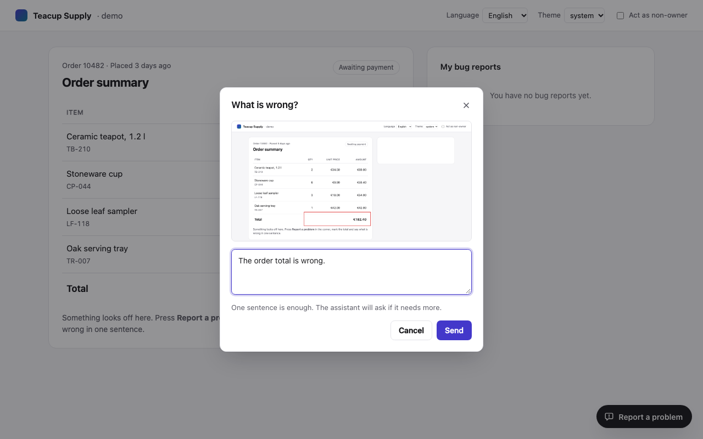
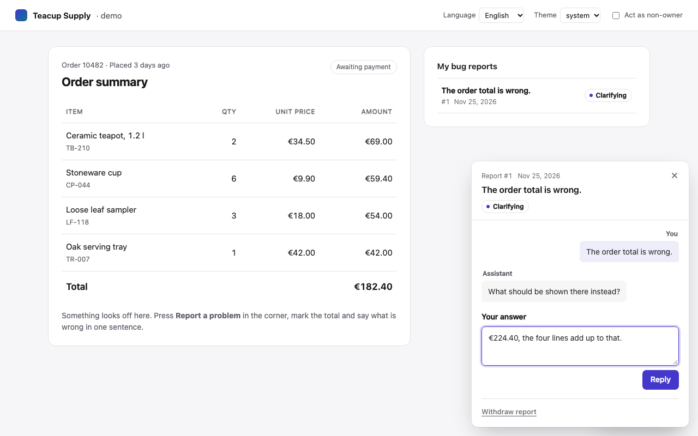
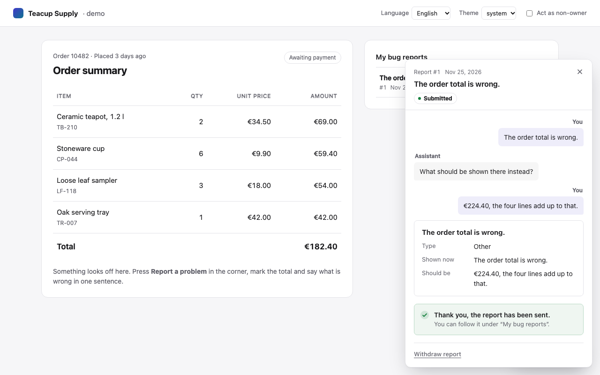

# Elicitor

An in-app bug report and feature request widget. The user marks a region of the screen and writes
one sentence; a language model asks a few short follow-up questions until the report can be
reproduced, then reads back a summary for the user to confirm.

Status: pre-release. Full documentation is coming.

Try it without an API key: `pnpm install && pnpm dev` runs the demo in `examples/vite-react`.

| Mark the problem                                | Say it in one sentence                            | Answer a question                                      |
| ----------------------------------------------- | ------------------------------------------------- | ------------------------------------------------------ |
|  |  |  |

| Confirm the summary                                  | Sent                                       |
| ---------------------------------------------------- | ------------------------------------------ |
|  |  |

| Package               | What it is                                                                          |
| --------------------- | ----------------------------------------------------------------------------------- |
| `@elicitor/core`      | Intake engine, prompt, output parser, fake model, in-memory store. No dependencies. |
| `@elicitor/anthropic` | Model adapter for the Anthropic SDK.                                                |
| `@elicitor/capture`   | Screen region marking and screenshot capture in the browser.                        |
| `@elicitor/react`     | React hooks over core and capture.                                                  |
| `@elicitor/react-ui`  | Ready-made React widget with styles.                                                |

Licence: MIT.
