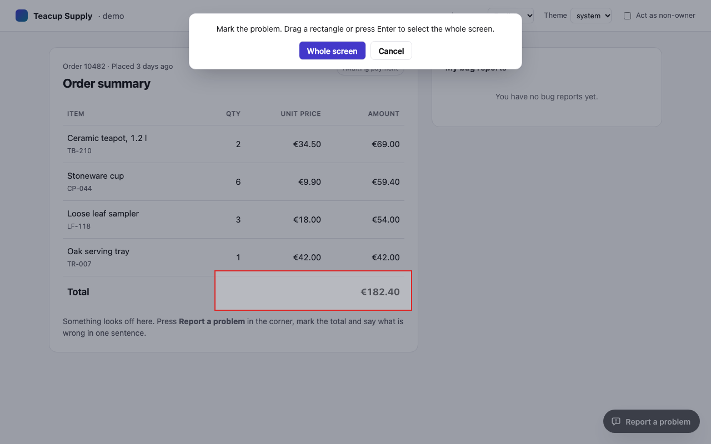
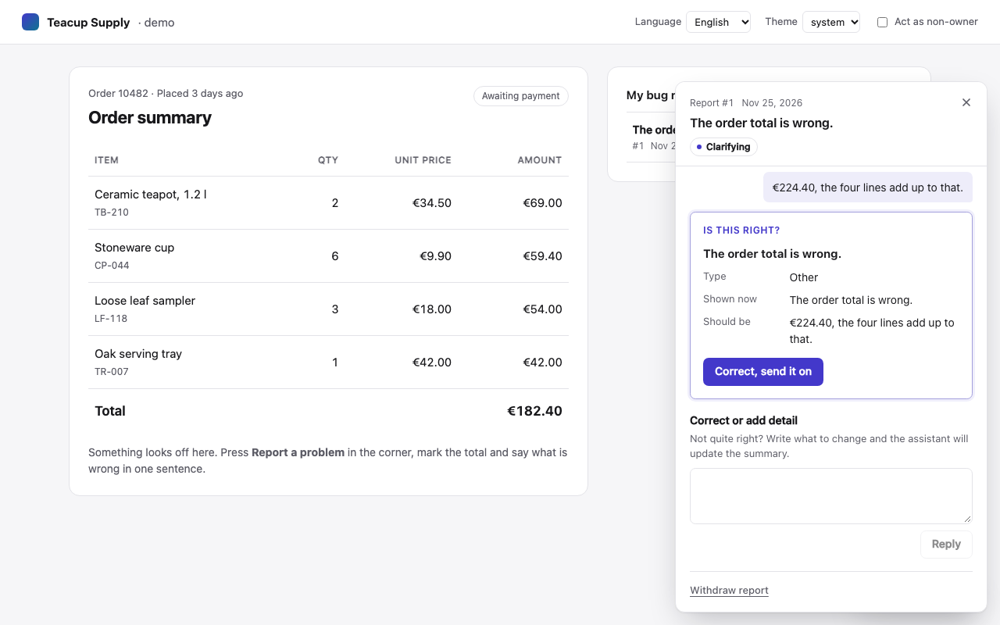

# Elicitor

An in-app bug report and feature request widget. The reporter marks the part of the screen that is
wrong and writes one sentence. A language model then asks a few short follow-up questions until
someone else could reproduce the problem, and reads a structured summary back for the reporter to
confirm. It fills the same place as Sentry User Feedback or PostHog's feedback tools, with three
differences: the intake is a short AI interview with read-back confirmation, the backend is yours
(any server, any database, any model provider through a small adapter), and the UI ships full
English, Estonian, Finnish and Russian bundles with per-key overrides.

| 1. Mark the problem                             | 2. One sentence                                   | 3. A follow-up question                                |
| ----------------------------------------------- | ------------------------------------------------- | ------------------------------------------------------ |
|  |  |  |

| 4. Confirm the read-back                             | 5. Sent                                    |
| ---------------------------------------------------- | ------------------------------------------ |
|  |  |

## Try it without an API key

```sh
pnpm install && pnpm dev
```

This runs `examples/vite-react`: a small order page with a wrong total, the widget and a report
list. A scripted fake model and an in-memory store run in the browser, so there is no server and no
key.

## Quick start

```sh
pnpm add @elicitor/react-ui                                     # browser
pnpm add @elicitor/core @elicitor/anthropic @anthropic-ai/sdk   # server
```

Client:

```tsx
import "@elicitor/react-ui/styles.css";
import { createFetchTransport, Elicitor, ElicitorProvider } from "@elicitor/react-ui";
import type { ReactNode } from "react";

const transport = createFetchTransport("/api/elicitor");

export function App({ children }: { children: ReactNode }) {
  return (
    <ElicitorProvider transport={transport} locale="en">
      {children}
      <Elicitor />
    </ElicitorProvider>
  );
}
```

Server: one handler over the Fetch API `Request`, so it fits any framework that gives you one. It
implements the REST shape that `createFetchTransport` speaks
([`packages/react/README.md`](packages/react/README.md#the-rest-shape)).

```ts
import { anthropicModel } from "@elicitor/anthropic";
import {
  type CreateReportInput,
  createIntake,
  createMemoryStore,
  isElicitorError,
} from "@elicitor/core";

// In memory: reports are lost on restart. Replace with your own ReportStore (docs/adapters.md).
const store = createMemoryStore();

const intake = createIntake({
  model: anthropicModel(), // reads ANTHROPIC_API_KEY
  store,
  prompt: { productDescription: "Acme Books, an online bookkeeping application" },
});

const STATUS: Readonly<Record<string, number>> = { not_found: 404, invalid: 400, stale: 409 };

const json = (status: number, body: unknown): Response =>
  new Response(body === null ? null : JSON.stringify(body), {
    status,
    headers: { "Content-Type": "application/json" },
  });

const notFound = (): Response => json(404, { error: { code: "not_found" } });

/** `userId` comes from your own session, never from the request body. */
export async function handleElicitor(request: Request, userId: string): Promise<Response> {
  const path = new URL(request.url).pathname.replace(/^\/api\/elicitor/, "");
  const [, resource, rawId, action] = path.split("/");
  if (resource !== "reports") return notFound();
  try {
    if (rawId === undefined) {
      if (request.method === "GET")
        return json(
          200,
          store.list((metadata) => metadata.userId === userId),
        );
      if (request.method !== "POST") return notFound();
      // Validate sizes and shapes here before trusting the body (docs/security.md).
      const input = (await request.json()) as CreateReportInput;
      const { id } = await intake.start({
        ...input,
        language: input.context.language,
        screenshotPng: input.screenshotPng || null,
        metadata: { ...input.metadata, userId }, // the owner is set by the server
      });
      return json(201, store.toListItem(id));
    }

    const id = decodeURIComponent(rawId);
    // Authorisation: only the reporter may see or act on a report.
    if (store.metadataOf(id)?.userId !== userId) return notFound();

    if (action === undefined && request.method === "GET") {
      store.markSeen(id);
      return json(200, store.toDetail(id, { canAct: true }));
    }
    if (request.method !== "POST") return notFound();
    if (action === "reply") {
      const { body } = (await request.json()) as { body: string };
      await intake.reply(id, String(body));
    } else if (action === "confirm") {
      const { expectedSeq } = (await request.json()) as { expectedSeq: number };
      await intake.confirm(id, Number(expectedSeq));
    } else if (action === "withdraw") {
      await intake.withdraw(id);
      return json(204, null);
    } else return notFound();
    return json(200, store.toDetail(id, { canAct: true }));
  } catch (error) {
    const code = isElicitorError(error) ? error.code : "internal";
    return json(STATUS[code] ?? 500, { error: { code } });
  }
}
```

Without an API key the adapter is "not configured": every report is still saved and moves straight
to `submitted` with a note that the assistant was unavailable. More in
[docs/quick-start.md](docs/quick-start.md).

## Packages

| Package                                     | What it is                                                                                   |
| ------------------------------------------- | -------------------------------------------------------------------------------------------- |
| [`@elicitor/core`](packages/core)           | Intake engine, store and model contracts, in-memory store, wire types. No dependencies.      |
| [`@elicitor/anthropic`](packages/anthropic) | Model adapter for the Anthropic SDK, direct or through a gateway.                            |
| [`@elicitor/capture`](packages/capture)     | Framework-free region marking, screenshot, region text and context capture in the browser.   |
| [`@elicitor/react`](packages/react)         | Headless React provider, hooks, fetch transport and an in-memory test transport.             |
| [`@elicitor/react-ui`](packages/react-ui)   | The ready-made widget: trigger, dialogs, thread, summary confirm, report list, one CSS file. |

An adapter for the Vercel AI SDK and a ready-made `@elicitor/server` are planned for 0.2. They do
not exist yet.

React: `peerDependencies` allow React 18 and the hooks use only APIs React 18 has, but the test
suite runs on React 19 only.

## Three levels of control

1. **Drop-in widget.** `<Elicitor />` renders a floating "Report a problem" button and the whole
   flow.
2. **Your own trigger.** `<Elicitor trigger={({ open, busy }) => <button onClick={open} disabled={busy}>Report</button>} />`
   renders your button in place of the floating one.
3. **Imperative or headless.** `<Elicitor trigger={null} />` and call
   `useElicitor().open({ labels: useMessages().overlayLabels })` from a menu item; or skip
   `@elicitor/react-ui` and build your own UI on `useElicitor`, `useReport` and `useCapture` from
   `@elicitor/react`.

## Privacy

Nothing is captured until the reporter opens the widget, with one exception: the console error
buffer (on by default) records `console.error` calls, window errors and unhandled rejections in
memory from the moment the provider mounts. When a report is created the browser sends:

- the sentence, the route (`location.pathname + location.search` by default), the marked rectangle;
- a PNG of the **whole visible viewport** with the marked region outlined (a region does not crop
  it);
- the rendered text inside the region (at most 200 entries of 500 characters);
- language, viewport size, user agent, an optional build id, the latest 30 console errors and the
  latest 50 request-log entries your app chose to record;
- whatever `getMetadata()` returns.

Screenshot, region text, user agent and console errors can each be switched off in the provider's
`capture` option; the request log and metadata are only sent if you supply them. Anything inside an
element with `data-elicitor-ui` (the widget's own trigger, dialogs and panel carry it) is left out of
the screenshot and region text. The model provider
receives the sentence, replies, route, region text, the context JSON and the screenshot; it does
not receive the metadata or the rectangle coordinates. Storage, encryption, retention and
authorisation are the host's. Full field list: [docs/privacy.md](docs/privacy.md).

## Documentation

- [Quick start](docs/quick-start.md)
- [Privacy: what is collected](docs/privacy.md)
- [Security notes](docs/security.md)
- [Adapters: model, store, transport](docs/adapters.md)
- [Theming](docs/theming.md)
- [Texts and languages](docs/i18n.md)
- [Releasing](docs/releasing.md)
- Package references: [core](packages/core/README.md), [anthropic](packages/anthropic/README.md),
  [capture](packages/capture/README.md), [react](packages/react/README.md),
  [react-ui](packages/react-ui/README.md)

## Status

0.x. The API may change between minor versions until 1.0; breaking changes are listed in each
package's changelog.

## Licence

MIT. See [LICENSE](LICENSE).
